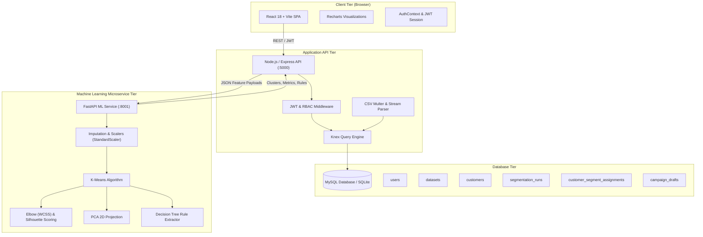

# CustomerSeg — AI-Powered Customer Segmentation & Management System

> **Academic Presentation Reference**  
> **Institution:** IPS Academy, Institute of Engineering and Science, Indore  
> **Department:** Department of Computer Science and Engineering  
> **Academic Year:** 2026–27  
> **Project Guide:** Ms. Arpita Bhatia  
> **Presented By:** Avani Gupta  

---

## 1. Executive Summary

**CustomerSeg** is an enterprise-grade customer segmentation and management web platform designed to transform raw customer transactional and demographic data into quantitative, actionable marketing intelligence.

Unlike basic visualization dashboards or static mockups, CustomerSeg features a decoupled microservice architecture:
- **React 18 & Vite Frontend** styled with Tailwind CSS, Lucide icons, and Recharts visual analytics.
- **Node.js & Express RESTful API** equipped with JWT authentication, role-based access control (Admin, Analyst, Viewer), CSV stream validation, and centralized error handling.
- **Relational Database Management** targeting MySQL with relational schemas, foreign keys, and indexes, along with an automatic persistent SQLite mode for instant local developer evaluation.
- **Python FastAPI ML Microservice** utilizing Scikit-learn, Pandas, and NumPy to execute real-time K-Means clustering, automated Elbow-method analysis, Silhouette validation, 2D PCA dimensionality reduction, and white-box Decision Tree classification rule extraction.

---

## 2. System Architecture



---

## 3. Core Features

1. **Public Landing Page:**
   - Academic credentials banner highlighting IPS Academy Indore, Department of CSE (2026–27), Guide: Ms. Arpita Bhatia, Presented by: Avani Gupta.
   - Six-step segmentation workflow walkthrough.
   - Interactive system architecture overview, technology stack, and academic citations.
2. **Interactive Overview Dashboard:**
   - Real-time quantitative KPI cards: *Total Customers, Active Customers, AI Segments, High-Value Cohort, At-Risk Customers, Average Customer Value*.
   - Recharts visual graphs: Customer Distribution Donut, Revenue Contribution Bar Chart, Multi-Feature Comparison, 2D PCA Scatter Plot, Purchase Frequency Histogram, Spending Brackets.
   - Dynamic dataset switcher and segment filtering.
3. **Customer Management Module:**
   - Server-paginated customer directory with multi-column sorting (Customer ID, Name, Income, Spending Score, Total Spend).
   - Search by ID, name, or email.
   - Slide-over Customer Inspection Profile Drawer with distance-to-centroid and PCA coordinates.
   - Instant export of filtered records to CSV.
4. **AI Segmentation Studio (8 Steps):**
   - Step 1: Upload or select existing dataset.
   - Step 2: Interactive feature column selection (excludes identifiers to prevent algorithmic bias).
   - Step 3: Data preprocessing (configurable Mean, Median, or Drop imputation; StandardScaler, MinMaxScaler, or RobustScaler).
   - Step 4: Algorithm tuning with automated Elbow curve (WCSS) & Silhouette score recommendation.
   - Step 5: Real-time ML execution dispatch.
   - Step 6: Visual analytics with 2D PCA cluster projection, silhouette scores, and Davies-Bouldin metrics.
   - Step 7: Data-backed segment profiles with automated business strategies and Decision Tree white-box rules.
   - Step 8: Customer assignment CSV export.
5. **Datasets Module:**
   - Upload customer CSV datasets (up to 15MB) with automated column parsing and missing value detection.
   - One-click loader for the built-in *Mall Customers* and *E-Commerce Benchmark* datasets.
   - Referential integrity protections on dataset deletion.
6. **Campaign Management:**
   - Target segment selector with real-time calculated audience reach.
   - Email, SMS, and Push notification channel support.
   - Message template drafting with dynamic variables (`{{CustomerName}}`, `{{SegmentName}}`, `{{CustomerID}}`).
   - Strict safety rule: No simulated fake sends; drafts are preserved safely in draft status.
7. **Role-Based Administration & Security:**
   - Three role tiers: **Administrator**, **Data Analyst**, and **Viewer**.
   - Admin user role promotion/demotion.
   - Tamper-evident system activity audit trail log.
8. **Technical Documentation & Health Diagnostics:**
   - User manual, mathematical formulations, REST API route table, and live health monitors for backend, database, and Python ML service.

---

## 4. Technology Stack & Prerequisites

### Prerequisites
- **Node.js**: v18+ (tested on Node v24.14.0)
- **npm**: v9+ (tested on npm 11.9.0)
- **Python**: 3.10+ (tested on Python 3.13.9)
- **MySQL Server** (optional; built-in SQLite developer fallback provided)
- **Docker & Docker Compose** (optional for containerized deployment)

---

## 5. Local Setup & Execution Guide

### Option A: Running Services Locally

#### 1. Start the Python ML Service
```powershell
cd ml-service
python -m pip install -r requirements.txt
python -m uvicorn app.main:app --host 127.0.0.1 --port 8001
```
*ML Service will be live at: http://127.0.0.1:8001 (Docs at http://127.0.0.1:8001/docs)*

#### 2. Start the Backend API
In a new terminal:
```powershell
cd backend
npm install
npm start
```
*Backend API will run at: http://127.0.0.1:5000 (Health check: http://127.0.0.1:5000/api/v1/health)*

#### 3. Start the React Frontend
In a third terminal:
```powershell
cd frontend
npm install
npm run dev
```
*Frontend will be accessible at: http://localhost:5173*

---

### Option B: Docker Compose (All Services Containerized)

To run the entire stack (MySQL 8.0, Python ML, Node.js Backend, and Nginx React Frontend):
```bash
docker compose up --build
```
The application will be live at `http://localhost`.

---

## 6. Pre-Configured Demo Credentials

The database seeder automatically initializes three demo accounts:

| Role | Email Address | Password | Permissions |
| :--- | :--- | :--- | :--- |
| **Administrator** | `admin@customerseg.com` | `Admin@123456` | Full system access, dataset deletion, user role administration |
| **Lead Analyst** | `analyst@customerseg.com` | `Analyst@123456` | Ingest datasets, configure & run segmentation, create campaigns |
| **Viewer** | `viewer@customerseg.com` | `Viewer@123456` | Read-only access to dashboard, customers, and reports |

*Quick-login buttons are provided directly on the login page for instantaneous evaluation.*

---

## 7. Machine Learning Methodology

1. **Standardization:**
   Features are transformed using `StandardScaler` to zero mean and unit variance:
   $$z = \frac{x - \mu}{\sigma}$$
   This prevents high-magnitude features (e.g., Annual Income in \$10,000s) from dominating distance metrics relative to bounded features (e.g., Spending Score 1–100).
2. **K-Means Clustering:**
   Partitions customers into $k$ non-overlapping clusters by minimizing the within-cluster sum of squares (WCSS / Inertia):
   $$\text{WCSS} = \sum_{k=1}^{K} \sum_{x \in S_k} ||x - \mu_k||^2$$
3. **Elbow Method & Silhouette Validation:**
   The elbow curve plots WCSS across $k=2 \dots 8$. Simultaneously, the Silhouette coefficient assesses cluster separation quality:
   $$s(i) = \frac{b(i) - a(i)}{\max(a(i), b(i))}$$
4. **Dimensionality Reduction (PCA):**
   Principal Component Analysis projects the $N$-dimensional feature space onto 2 principal orthogonal axes for 2D visualization while reporting explained variance ratios.
5. **White-Box Rule Extraction:**
   A `DecisionTreeClassifier` is trained on the resulting cluster labels to output human-readable decision rules in plain text.

---

## 8. Verification & Test Execution Results

### 1. Python ML Service Automated Unit Tests
Executed via `pytest`:
```bash
cd ml-service
python -m pytest tests -v
```
**Results:** `7 passed, 0 failed`
- `test_preprocessing_standard`: PASSED
- `test_missing_value_drop_strategy`: PASSED
- `test_constant_feature_handling`: PASSED
- `test_invalid_feature_selection_raises`: PASSED
- `test_kmeans_clustering_reproducibility`: PASSED
- `test_elbow_curve_calculation`: PASSED
- `test_small_dataset_cluster_count_validation`: PASSED

### 2. Backend Node.js Integration Tests
Executed via `node --test`:
```bash
cd backend
npm test
```
**Results:** `10 passed, 0 failed`
- `GET /health returns operational`: PASSED
- `POST /auth/login returns token & role`: PASSED
- `POST /auth/login viewer user`: PASSED
- `POST /auth/login invalid credentials rejection (401)`: PASSED
- `GET /dashboard/summary returns verified KPIs`: PASSED
- `GET /customers pagination & segment joins`: PASSED
- `GET /customers/export downloads CSV stream`: PASSED
- `Viewer role cannot delete dataset (RBAC 403)`: PASSED
- `GET /admin/users restricted to admin`: PASSED
- `GET /campaigns lists draft campaigns`: PASSED

### 3. Production Frontend TypeScript & Vite Build
Executed via `npm run build`:
```bash
cd frontend
npm run build
```
**Results:** Built successfully in 6.31s with zero TypeScript diagnostics errors (`dist/assets/index.js` generated).

---

## 9. Production Deployment Guide

### Live Public Deployments
* **Frontend Application (Vercel):** [https://frontend-sigma-liart-89.vercel.app](https://frontend-sigma-liart-89.vercel.app)
* **GitHub Repository:** [https://github.com/ROBUST-Anuj/CustomerSeg](https://github.com/ROBUST-Anuj/CustomerSeg)

### Architecture in Production
| Tier | Host | Status / Setup |
| :--- | :--- | :--- |
| **Frontend** | **Vercel** | **Live** at `https://frontend-sigma-liart-89.vercel.app` (SPA rewrites configured in `vercel.json`). |
| **Backend API** | **Render / Railway** | Configured via `render.yaml` (free web service, Node.js runtime). |
| **ML Microservice** | **Render / Cloud Run** | Configured via `render.yaml` (free web service, Python 3.11 runtime, Scikit-learn). |
| **Database** | **TiDB Serverless / Aiven** | Free tier MySQL 8.0 wire-compatible relational database with SSL support. |

---

### Step-by-Step Production Hosting Deployment

#### 1. Database (Persistent Cloud MySQL — Free, No Credit Card)
1. Create a free MySQL database on **TiDB Serverless** ([tidbcloud.com](https://tidbcloud.com/)) or **Aiven MySQL** ([aiven.io](https://aiven.io/)).
2. Retrieve your connection string, for example:
   ```text
   DATABASE_URL=mysql://<user>:<password>@<host>:4000/<dbname>?ssl={"rejectUnauthorized":false}
   ```
   *(CustomerSeg's Knex engine automatically parses `DATABASE_URL` and enables SSL certificates).*

#### 2. Backend & ML Services (Render 1-Click Blueprint)
1. Go to [dashboard.render.com](https://dashboard.render.com/) and click **New +** &rarr; **Blueprint**.
2. Connect the repository `ROBUST-Anuj/CustomerSeg`.
3. Render will automatically detect `render.yaml` and provision:
   - `customerseg-ml-service` (Python FastAPI microservice).
   - `customerseg-backend` (Node.js API with JWT auth and database migrations).
4. In the Render Dashboard for `customerseg-backend`, set the environment variable:
   - `DATABASE_URL`: Your cloud MySQL connection string.
   - `CORS_ORIGIN`: `https://frontend-sigma-liart-89.vercel.app`

#### 3. Connect Frontend to Deployed Backend
In your Vercel project dashboard under **Settings &rarr; Environment Variables**:
1. Add `VITE_API_BASE_URL` = `https://<your-backend-subdomain>.onrender.com/api/v1`
2. Redeploy the project on Vercel (`npx vercel --prod`).

---

## 10. Operational Limitations & Troubleshooting

1. **Free-Tier Cold Starts:** On free hosting tiers (such as Render free web services), inactive services spin down after 15 minutes of inactivity. Initial requests after dormancy may take 30–50 seconds to initialize.
2. **Persistent Storage:** Uploaded CSV files on cloud container platforms are streamed into the relational database (`customers` and `datasets` tables) to prevent reliance on ephemeral container disk files.
3. **Database Security:** Cloud MySQL hosts require TLS/SSL encryption. CustomerSeg automatically enforces `ssl: { rejectUnauthorized: false }` when connecting to remote hosts.

---

## 11. References & Acknowledgments

- **React.js**: [https://react.dev/](https://react.dev/)
- **Node.js**: [https://nodejs.org/](https://nodejs.org/)
- **Express.js**: [https://expressjs.com/](https://expressjs.com/)
- **MySQL**: [https://dev.mysql.com/doc/](https://dev.mysql.com/doc/)
- **Scikit-learn**: [https://scikit-learn.org/](https://scikit-learn.org/)
- **TensorFlow**: [https://www.tensorflow.org/](https://www.tensorflow.org/)
- **Harvard Business Review**: Customer Segmentation & Analytics Decision Frameworks
- **McKinsey & Company**: Modern Marketing Personalization Insights

**Project Presentation:** IPS Academy, Institute of Engineering and Science, Indore &bull; Department of Computer Science & Engineering (2026–27).  
**Faculty Guide:** Ms. Arpita Bhatia  
**Presented by:** Avani Gupta  

